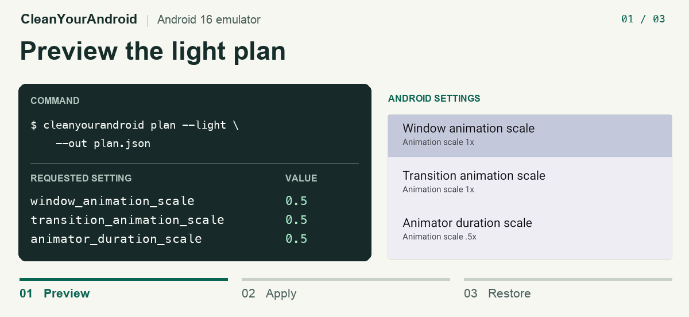

# CleanYourAndroid

[](https://github.com/shiv-eshwar/cleanyourandroid/actions/workflows/ci.yml) · [MIT license](LICENSE) · [Changelog](CHANGELOG.md)

Disable unused factory apps, reduce OEM recommendations, and shorten transitions on your Android phone. CleanYourAndroid runs on your computer over [ADB](https://developer.android.com/tools/adb). You keep your launcher, firmware, and system updates.

**No root required.** You review the exact changes before they run; nothing needs to be installed on the phone. The cleaner does not open your photos, downloads, chats, contacts, or app contents.

<picture>
  <source media="(prefers-reduced-motion: reduce)" srcset="docs/images/light-plan.png">
  
</picture>

*Watch Window and Transition change from 1× to 0.5× and back. Animator duration already displayed 0.5×. These are real Android 16 emulator screenshots alongside selected CLI output.* [Still image](docs/images/light-plan.png) · [Capture notes](docs/demo/README.md)

## Quick start

Install [Android SDK Platform-Tools](https://developer.android.com/tools/releases/platform-tools), put `adb` on your PATH, then enable **USB debugging** on your phone. Connect a data cable and accept the authorization prompt. [USB troubleshooting and Wi-Fi pairing →](docs/connect.md)

Install the CLI with [uv](https://docs.astral.sh/uv/):

```sh
uv tool install --python 3.12 "git+https://github.com/shiv-eshwar/cleanyourandroid.git"
cleanyourandroid devices
cleanyourandroid audit
```

`devices` and `audit` are read-only. The audit shows free storage, estimated app caches, battery condition, animation settings, and eligible preinstalls. If two devices are online, add `--serial YOUR_SERIAL` after the subcommand.

<details>
<summary>Run from source with Python 3.10+ (no uv needed)</summary>

```sh
git clone https://github.com/shiv-eshwar/cleanyourandroid.git
cd cleanyourandroid
python -m cleanyourandroid devices
python -m cleanyourandroid audit
```

The core CLI has no third-party Python dependencies. To use the shorter `cleanyourandroid` command in the examples below, run `python -m pip install .` in an activated virtual environment.

</details>

## Try the light preset

Start with a preview. This writes a file **on your computer**:

```sh
mkdir .cyandroid
cleanyourandroid plan --light --out .cyandroid/plan.json
```

Read `observed` for the current values, `operations` for what would change, and `review_notes` for the tradeoffs. The preset proposes 0.5× for unset or slower animations; it preserves reduced motion and animations that are already off. On eligible Xiaomi and OPPO builds, it can also propose disabling a dedicated ad service. Cache clearing, app stores, DNS, and battery settings are separate choices.

If you want those changes, replace `YOUR_REVIEWED_SHA256` with the digest the preview printed:

```sh
cleanyourandroid apply .cyandroid/plan.json --approve YOUR_REVIEWED_SHA256 --journal .cyandroid/journal.json
```

Try a familiar gesture, such as opening Settings from Quick Settings. Shorter transitions can feel quicker without changing the display's frame rate. If you prefer the original feel, restore from the journal:

```sh
cleanyourandroid restore .cyandroid/journal.json
```

Keep the journal even if the cable disconnects. Use fresh filenames on your next run. [How recovery works →](docs/safety.md)

## Choose individual changes

| If you want to… | Start here |
| --- | --- |
| **Reduce OEM ads** | Run `cleanyourandroid ads`. Look for **MSA** on Xiaomi/Redmi/POCO, **App Market recommendations** on OPPO, or **Hot Apps / Hot Games** on vivo. Optional Private DNS filters domains; it cannot block every ad. [OEM guide](docs/ads-and-preinstalls.md) |
| **Hide an unused preinstall** | Choose a package the audit marks eligible. Disabling keeps its APK and app data. Per-user removal is a separate option for eligible factory apps; the system APK stays on the phone. [Package options](docs/maintenance.md) |
| **Free storage** | Start with the largest cache estimates in `audit`. If Android denies cache-only clearing, `cleanyourandroid cache-settings PACKAGE` opens App info. Choose **Clear cache**. **Clear storage** erases app data. Cleared cache cannot be restored. [Cache options](docs/maintenance.md) |
| **Investigate battery drain or lag** | Run `cleanyourandroid diagnose`. Compare frame timing or screen-off drain under the same conditions before changing a Battery Saver schedule. A health status such as `good` does not tell you remaining capacity; software can't repair a worn cell. [Performance guide](docs/performance.md) |

Package changes target Android user 0. Animation, power, and DNS settings are device-wide. See [all plan options and how to compare before/after audits](docs/maintenance.md).

## What has been tested?

| Evidence | What it establishes |
| --- | --- |
| [Android 16 emulator and desktop CI](https://github.com/shiv-eshwar/cleanyourandroid/actions/workflows/ci.yml) | A disposable emulator checks apply/restore and Android's cache permission boundary using a throwaway app. The CLI suite also runs on Linux, macOS, and Windows. |
| [Nothing Phone (2a) USB screenshot](docs/images/live-diagnostic.png) | A read-only hardware session returned live diagnostic values. It's a snapshot, not a speed benchmark. |
| [Xiaomi, OPPO, and vivo rules](docs/ads-and-preinstalls.md) | Simulated devices exercise package matching and protections. Physical validation of **this CLI's rules** on those manufacturers is still pending. Menus and packages vary by firmware and region. |

Reports stay on the computer running the CLI. Raw audits may contain package names and build details. For a report you can share without app names or device IDs, use [the offline comparison](docs/maintenance.md#measure-the-result).

## Contribute

A useful [device report](https://github.com/shiv-eshwar/cleanyourandroid/issues/new?template=device-report.yml) includes the model, firmware, action tried, and whether restore worked. Leave out serial numbers, account details, and personal content.

[Contributing](CONTRIBUTING.md) · [Private security reporting](SECURITY.md) · [Coding agents and read-only MCP](docs/agents.md)

Inspired by [CleanYourTV](https://github.com/Gathin23/cleanyourtv). Critical-package identifiers and protection patterns are adapted from [Shibakaa/cleanyourdroid](https://github.com/Shibakaa/cleanyourdroid/tree/6234b0b054d86f348b5fcb2f87fe4b04290e6f79) under [its MIT license](LICENSES/cleanyourdroid-MIT.txt). Its before/after reports inspired the offline comparison.
