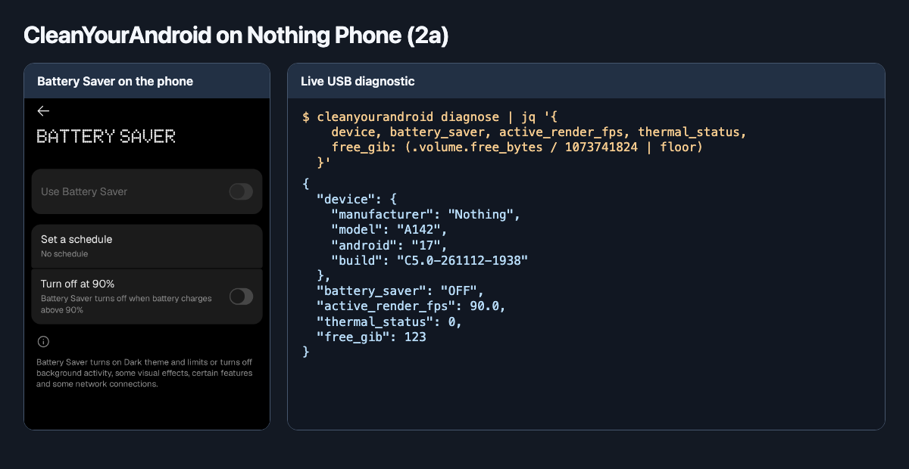

# CleanYourAndroid

[](https://github.com/shiv-eshwar/cleanyourandroid/actions/workflows/ci.yml) · [MIT license](LICENSE)

Reduce preinstalled clutter, shorten animations, and cut down on ads on the Android phone you already own. CleanYourAndroid runs on your computer over [ADB](https://developer.android.com/tools/adb). You keep your launcher, firmware, and system updates. No root, bootloader unlock, or app installation on the phone is needed.

**The cleaner does not scan photos, downloads, messages, contacts, or app contents.** It asks Android for system measurements, package metadata, and settings. It shows exactly which packages and settings a plan would change before you apply it.

## Quick start

1. Install Python **3.10 or newer** and [Android SDK Platform-Tools](https://developer.android.com/tools/releases/platform-tools). Put `adb` on your PATH, or set `CLEANYOURANDROID_ADB` to its full path.
2. Enable **USB debugging**, connect a data cable, and accept the authorization prompt on your phone. See [USB setup, Windows drivers, and wireless pairing](docs/connect.md) if the phone doesn't appear.
3. Install the CLI. With [uv](https://docs.astral.sh/uv/), run:

   ```sh
   uv tool install --python 3.12 "git+https://github.com/shiv-eshwar/cleanyourandroid.git"
   ```

   Alternatively, clone this repository and run `python -m pip install .` in an activated virtual environment. From the checkout you can also substitute `python -m cleanyourandroid` for the installed command. The core CLI has no third-party Python dependencies.

```sh
cleanyourandroid devices
cleanyourandroid audit
cleanyourandroid ads
```

These commands are read-only. In `audit`, look for free space, the largest estimated caches, animation scales, battery condition, and eligible preinstalls. In `ads`, look for the controls specific to your manufacturer. If more than one device is online, add `--serial YOUR_SERIAL` after the subcommand.

## Try the light preset

```sh
mkdir .cyandroid
cleanyourandroid plan --light --out .cyandroid/light.json
```

The preset proposes **0.5× animations** for scales that are unset or higher than 0.5×. It preserves motion that's already reduced or off. On supported Xiaomi and OPPO builds it can also propose disabling a verified, dedicated advertising service. It doesn't select app stores, uninstall apps, choose a DNS provider, clear caches, or change Battery Saver. If nothing qualifies, it says so.

Read the printed `operations`, `observed` values, and `review_notes`. To proceed, replace the placeholder below with the `approval_sha256` printed for **that plan**:

```sh
cleanyourandroid apply .cyandroid/light.json --approve PASTE_REVIEWED_SHA256_HERE --journal .cyandroid/light-journal.json
cleanyourandroid diagnose
```

Try the same app or gesture again. To undo the reversible changes, use the same phone and journal:

```sh
cleanyourandroid restore .cyandroid/light-journal.json
```

Use fresh plan and journal filenames for each run. The journal is written before the first change; keep it if the connection drops. [Recovery and older 0.2 file backups](docs/safety.md).

## Choose individual changes

Use the options below with `cleanyourandroid plan … --out .cyandroid/NAME.json`, then review and apply as above. Each option is independent.

| Goal | Option | What changes |
| --- | --- | --- |
| Hide bloatware | `--disable-package PACKAGE` | Stops an eligible system preinstall for the primary user. Its APK and app data stay on the phone. Start here if you may want it back. |
| Remove a preinstall | `--remove-preinstall PACKAGE` | For an eligible factory APK, Android removes it for user 0 and keeps its data. The system APK remains, so this can reclaim little space. |
| Reduce network ads | `--private-dns HOSTNAME` | On Android 9+, use a DNS-over-TLS resolver you choose. A filtering resolver sees DNS queries and can affect connectivity. [Provider example and rollback](docs/ads-and-preinstalls.md#filter-network-ads-with-private-dns). |
| Adjust motion | `--animation-scale 0.5` | Sets window, transition, and animator duration. Choose `0` for off or `1` for standard. Shorter animations do not increase frame rate. |
| Extend battery runtime | `--battery-saver-at 20` | Requests Battery Saver at 15%, 20%, or 25% on a percentage schedule. Check the OEM Battery settings. `--disable-auto-saver` turns that trigger off. |
| Reduce cellular standby use | `--disable-always-on-mobile-data` | Allows cellular data to idle on Wi-Fi; switching back to cellular may take longer. |
| Reclaim temporary space | `--clear-cache PACKAGE` | Requests cache-only clearing for a named installed app; repeat for multiple apps. Cleared cache cannot be restored. |
| Review large caches together | `--clear-cache-above-mib 128` | Lists installed third-party apps whose cached estimate is at least 128 MiB. The exact list is frozen in the plan. Android's estimates may be stale. |

**When cache clearing is unavailable:** check `cache_only_supported` in the audit. Some phones advertise cache clearing but deny ADB the required permission. Run `cleanyourandroid cache-settings PACKAGE` to open that app's info screen, then choose **Storage → Clear cache** yourself. **Clear storage / Clear data** erases app data. The CLI never uses it as a fallback. Apps can rebuild cache, use network data, and load more slowly after clearing; target storage pressure rather than clearing on a schedule.

For a standby-drain investigation, `cleanyourandroid scan-settings` opens Android's Wi-Fi and Bluetooth scanning controls. You can review each switch on the phone without sharing your location or nearby networks. Turning scanning off may reduce location accuracy; the CLI does not change either switch.

## Measure the result

Save one audit before maintenance and another afterward, on the same phone and firmware. Run the comparison after disconnecting if you like:

```sh
cleanyourandroid audit --out .cyandroid/before.json
# Apply your reviewed changes and repeat the activity you want to measure.
cleanyourandroid audit --out .cyandroid/after.json
cleanyourandroid compare-audits .cyandroid/before.json .cyandroid/after.json --html .cyandroid/report.html
```

The comparison prints JSON and can write a local HTML table. It exports only timestamps, free storage, available memory, and package counts; it omits app names, device identifiers, and network settings. Missing readings are `null` in JSON and appear as a dash in HTML. These snapshots cannot prove faster launches or longer battery life. For those questions, use the frame and standby comparisons in the [performance guide](docs/performance.md).

## What to expect on your phone

| Phone | Where to start |
| --- | --- |
| Xiaomi / Redmi / POCO (MIUI or HyperOS) | Check for MSA and the recommendation switches in Security, Themes, and GetApps. Package variants are matched separately. |
| OPPO (ColorOS) | Check App Market recommendation settings and whether the audit recognizes a dedicated advertising component. |
| vivo (Funtouch OS / OriginOS) | Check **Hot Apps / Hot Games** in V-Appstore. Keep the store if you need its app updates. |
| Other Android phones | Try diagnostics and motion settings. Selected cross-brand preinstalls can qualify; unrecognized packages remain inventory only. |

The [OEM guide](docs/ads-and-preinstalls.md) lists exact package names, update tradeoffs, and protection checks. OEM menus and permissions vary by model, region, and build. Package operations target primary user 0. Animation, power, and DNS settings are device-wide. Hardware support for the vivo, OPPO, and Xiaomi rules is **not yet confirmed**; the repository tests them with simulated devices. On a [disposable Android 16 emulator](https://github.com/shiv-eshwar/cleanyourandroid/actions/runs/45592454907), CI verified settings rollback and the manual cache fallback against a throwaway app with separate cache and data markers.

You can make a phone feel closer to stock Android without installing a Pixel ROM. Actual speed still depends on hardware, heat, storage, apps, and firmware. DNS cannot filter an ad served from the same domain as the content. Android's battery health status describes a condition such as `good` or `overheat`; it cannot measure remaining capacity on every phone or repair a worn cell. Use the [performance guide](docs/performance.md) to compare frame timing and standby drain under the same conditions.



*An earlier read-only hardware check on a Nothing Phone (2a). A single render-rate reading is not a before-and-after benchmark.*

## Privacy, agents, and contributions

Reports stay on the computer that runs the CLI. They can contain installed package names and build or network details. Keep plans and journals under `.cyandroid/` (ignored by Git), and share only the values needed to explain a result. If you connect a coding assistant, its own data handling applies. [Agent and read-only MCP setup](docs/agents.md).

[Contributing](CONTRIBUTING.md) · [Report a device result](https://github.com/shiv-eshwar/cleanyourandroid/issues/new?template=device-report.yml) · [Report a security issue privately](SECURITY.md) · [Changelog](CHANGELOG.md). A useful compatibility report names the model and firmware, the feature tested, and whether restore worked. Please leave device identifiers and personal content out.

Inspired by [CleanYourTV](https://github.com/Gathin23/cleanyourtv). The critical-package identifiers and protection patterns were adapted from [Shibakaa/cleanyourdroid](https://github.com/Shibakaa/cleanyourdroid/tree/6234b0b054d86f348b5fcb2f87fe4b04290e6f79) under [its MIT license](LICENSES/cleanyourdroid-MIT.txt). Its before/after reports inspired the offline comparison. CleanYourAndroid is an independent project.
